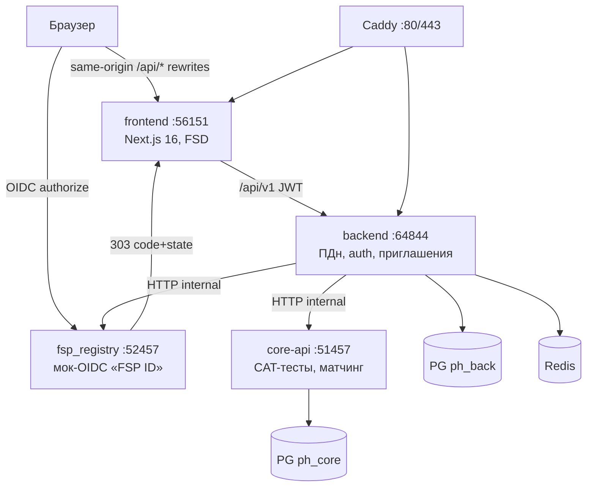

# Архитектура PirateHunter

Платформа-агрегатор ИТ-вакансий с обратной механикой: работодатель сам
находит кандидата в категоризованной базе. Четыре сервиса в монорепо,
общение только по HTTP, ноль shared-кода (принципы унаследованы от
проекта piratepitch). Живой сервис: **https://piratehunter.fun**.

## Диаграмма



Второй вариант — та же схема текстом (для печати):

```
                 Браузер
        ┌──────────┴───────────┐
        │ same-origin /api/*   │ OIDC: /oidc/authorize → 303 (code,state)
        ▼                      ▼                 │
 frontend :56151      fsp_registry :52457 ───────┘
 Next.js (FSD)        мок-OIDC «FSP ID» + реестр достижений
        │                      ▲
        │ /api/v1 (JWT)        │ HTTP (внутр. docker-сеть)
        ▼                      │
 backend :64844 ──────────────┘
 /api/v1 · auth · ПДн · приглашения
 PG ph_back · Redis
        │ HTTP (внутр. docker-сеть, наружу не выставлен)
        ▼
 core-api :51457 — CAT-тест-движок, матчинг, каталог
 PG ph_core

 Caddy :80/:443 → frontend (сайт) + backend (/api/v1), TLS автоматически
```

## Сервисы и порты

| Сервис | Порт | Наружу | Назначение |
|---|---|---|---|
| frontend | 56151 | да (через Caddy) | Next.js 16 (App Router, FSD): лендинг + ЛК кандидата + ЛК работодателя одним приложением |
| backend | 64844 | да (`/api/v1`, JWT) | Auth (email-код / FSP ID / dev-login), профили, ПДн, потребности, приглашения, рынок вилок |
| core-api | 51457 | нет (internal) | Тест-движок CAT, матчинг, каталог специализаций, LLM-парсинг потребностей |
| fsp_registry | 52457 | нет (internal)* | Мок-реестр достижений ФСП + мок-OIDC-провайдер «FSP ID» |
| pg-back / pg-core | 5432 | нет | PostgreSQL 16, отдельная БД на сервис: `ph_back` / `ph_core` |
| redis | 6379 | нет | Коды auth, OIDC state, кэш профилей ФСП, лимиты |
| caddy | 80/443 | да | TLS (Let's Encrypt, HTTP-01), reverse proxy |

\* В проде fsp_registry выставляется отдельным поддоменом `fsp-id.*`
только для authorize-страницы мок-OIDC (браузер должен на неё зайти);
все остальные его эндпоинты — внутренние. См. `Caddyfile`.

## Принципы (PRD §4.2)

- **Ноль shared-кода** — сервисы общаются только по HTTP. Frontend знает
  только backend; backend знает core-api и fsp_registry. Ни один сервис
  не импортирует код другого.
- **Свои PG + Redis** у backend и hunter_core — независимые релизы и
  миграции (Alembic у backend).
- **core-api и fsp_registry наружу не выставлены** — Caddy их не
  проксирует; в dev-compose порты опубликованы на `127.0.0.1` только
  для отладки и смоука.
- **ПДн только в backend** (privacy by design, аргумент для 152-ФЗ):
  ФИО, телефон, контакты, согласия живут в `ph_back` и никуда не
  уходят. core-api получает и хранит лишь анонимный `candidate_id` и
  оценочный снапшот. fsp_registry хранит синтетические достижения без
  ПДн; привязка `fsp_id ↔ candidate_id` — только в backend.
- **Детерминированные fallback везде**: LLM-фичи (парсинг потребности,
  перефразировка заданий) работают и без ключа/сети — демо не зависит
  от внешних API.

## Потоки данных

### Оценочный снапшот (backend → core-api)

После каждого изменения профиля (тест пройден, ФСП привязан/отвязан,
профиль обновлён) backend пушит в core:

```
PUT /internal/snapshots/{candidate_id}
{candidate_id, spec, grade_verified, theta, test_score, fsp_score,
 stack[], updated_at}
```

`test_score: null` = «вычисли сам из θ». Матчинг читает **только**
снапшоты — подборка не дёргает backend и не видит ПДн.

### Результат подборки (core-api → backend)

`POST /internal/match` возвращает ranked `[{candidate_id, score,
explanation, in_category}]` → backend джойнит с профилями (`ph_back`),
применяет правила видимости (контакты скрыты до accept) и отдаёт фронту.
Кандидаты вне категории идут отдельным блоком «рядом с запросом»
(`in_category=false`).

### ФСП (backend → fsp_registry)

Backend по `fsp_id` запрашивает `GET /fsp/v1/profiles/{fsp_id}`,
считает `fsp_score` (формула — MATCHING.md), кэширует в Redis
(TTL 3600 с) и включает в снапшот. **404 = нет истории** →
`fsp_score = 0`, блок достижений не показывается (обязательный кейс ТЗ).

### Тест (backend → core-api, проксирование)

Frontend ходит на `POST /api/v1/tests/sessions` и
`POST /api/v1/tests/sessions/{id}/answers`; backend проксирует в
`core-api /internal/tests/...` с подстановкой `candidate_id`, возвращает
вопрос/результат. Состояние сессии CAT живёт в `ph_core`.

### Вход через FSP ID (redirect-цепочка)

Backend `/api/v1/auth/fsp/authorize` отдаёт `authorize_url` на
browser-facing адрес реестра (`BACK_FSP_PUBLIC_URL`, `login_hint` как
у OIDC); реестр 303-ит браузер на `BACK_FSP_REDIRECT_URI` = GET-callback
backend'а **на origin фронта** (Next проксирует `/api/*` — refresh-cookie
`ph_refresh` ставится на домен фронта); backend обменивает
code→token→userinfo и 303-ит на `/login/callback`, сессию поднимает
bootstrap через `/auth/refresh`. Подробно — FSP-INTEGRATION.md.

## Доменная модель (кратко, полная — PRD §5)

- **backend (`ph_back`)**: User, AuthCode, CandidateProfile (ФИО,
  контакты, стек, согласия 152-ФЗ), GradeState (кулдауны), Company,
  Need (потребность), Vacancy, Invitation (обязательная вилка ЗП),
  Application. Инвариант ТЗ: `salary_from/to` NOT NULL, `from ≤ to`,
  `salary_type` обязателен (gross/net подписан в UI).
- **hunter_core (`ph_core`)**: ItemTemplate (параметризованный шаблон:
  генератор экземпляра по seed + детерминированный чекер), TestSession,
  Answer, AssessmentSnapshot (единственное, что читает матчинг),
  BetaStat (калибровка сложности).
- **fsp_registry**: stateless детерминированный генератор
  `FspProfile(fsp_id, rating, ranks, contests, events)`; БД не нужна.

## Стек

Python 3.13 + FastAPI + Pydantic v2 + SQLAlchemy 2 (async) + Alembic,
pytest, ruff; numpy для IRT-математики; LLM — OpenRouter (open-weights
модель Qwen-класса) с детерминированным fallback. Frontend: Next.js
16.3.1 (App Router, React Compiler), Bun, Tailwind v4, Base UI,
zustand, ky, biome, архитектура FSD (`src/fsd/*`). Айдентика ФСП —
точные токены из брендбука (`accent #402FFF`, `ink #1B1C21`, Inter +
JetBrains Mono), тема — сменяемый слой (`tokens.fsp.css`).
